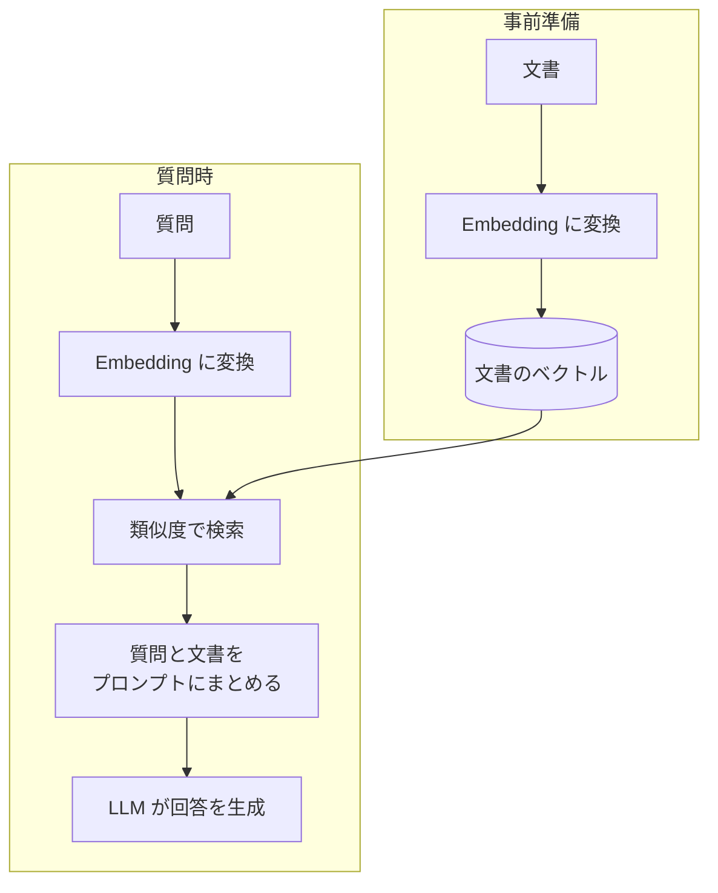

# Sarashina を利用した RAG システム実現例

## はじめに

SB Intuitions 株式会社の林悠大です。

この記事では、SB Intuitions が開発している LLM「Sarashina」の活用例として、RAG(検索拡張生成)を紹介します。

まず RAG の考え方と仕組みを説明し、Sarashina の API を使った最小構成の実装を示します。

## RAG とは

RAG(Retrieval-Augmented Generation、検索拡張生成)は、Lewis et al. (2020) で提案された手法です[1]。
LLM に回答を作ってもらう前に外部の情報を検索し、その結果を入力に加えます。
LLM が学習時に覚えた知識だけに頼らず、必要な情報をその場で渡して答えてもらう、というイメージです。

### なぜ RAG が必要か

LLM をそのまま業務で使おうとすると、次のような壁に当たることがあります。

- 学習データに含まれない情報は答えられない(社内文書、最新のニュースなど)
- 知らないことでも、もっともらしい答えを生成してしまう(ハルシネーション)
- 回答の根拠が分からず、正しいかどうかを確認しにくい

こうした課題を、モデルを再学習せずに緩和するのが RAG です。
質問に関係する文書を検索して渡してあげれば、LLM はその内容を根拠に答えられるようになります。

## RAG の仕組み

RAG は、事前準備と質問時の処理に分けて考えると分かりやすくなります。



事前準備として、検索対象の文書はあらかじめ Embedding に変換しておきます。

質問を受け取ったら、次の順に処理します。

1. 質問を Embedding に変換する
2. 文書のベクトルと比べて、質問に近い文書を検索する
3. 質問と検索した文書を一つのプロンプトにまとめる
4. LLM がプロンプトをもとに回答を生成する

Embedding は、文章の意味を数値のベクトルで表したもので、
意味が近い文章どうしはコサイン類似度が大きいベクトルになります。
質問と各文書の類似度を計算し、最も高い文書を「質問に関連する文書」として選びます。

## 簡単な例

一口に RAG といっても、検索方法の工夫や検索結果の絞り込みなど、具体的な手法はさまざまです。
この記事では、その中でも最もシンプルな手法をご紹介します。

### 事前準備

必要なライブラリをインストールします。

```bash
pip install -U requests numpy
```

Sarashina API を使うには API キーが必要です。
[sarashina.ai](https://sarashina.ai/#japanese) でキーを取得し、環境変数 SARASHINA_API_KEY に設定してください。

### Step 1: 文書を Embedding に変換する

検索対象の文書を、Embedding API でベクトルに変換します。

```python
API_BASE_URL = "https://api.sarashina.ai/v1"
HEADERS = {
    "Authorization": f"Bearer {os.environ['SARASHINA_API_KEY']}",
    "Content-Type": "application/json",
}
EMBEDDING_MODEL = "sarashina3-embedding"

# 検索対象の文書
DOCUMENTS = [
    "更級日記は、平安時代中期に菅原孝標女によって書かれた回想録です。",
    "サラシナエンベディングは日本語言語モデルをベースにした日本語埋め込みモデルです。",
    "Sarashinaは、SB Intuitionsが開発した日本語大規模言語モデルです。これまでに7B, 13B, 70B, 8x70Bのモデルが公開されています。"
]

def embed_text(text: str, task_type: str) -> list[float]:
    response = requests.post(
        f"{API_BASE_URL}/embeddings",
        headers=HEADERS,
        json={
            "model": EMBEDDING_MODEL,
            "input": text,
            "task_type": task_type,
        },
    )
    response.raise_for_status()
    return response.json()["data"][0]["embedding"]

print(embed_text(DOCUMENTS[0], task_type="RETRIEVAL_DOCUMENT")[:5])
# -> [1.2911771535873413, 0.13570536673069, 0.3547353446483612, 0.06406866759061813, -0.756546676158905]

```

task_type には、Embedding の用途を指定します。
ここでは検索される側の文書なので、`RETRIEVAL_DOCUMENT` を指定しています。
指定できる他の値は、[API ドキュメント](https://docs.sarashina.ai/api-reference/embeddings#task-type)を参照してください。

### Step 2: 質問に近い文書を検索する

質問を Embedding に変換し、類似度が最も高い文書を選びます。
質問側の task_type には `RETRIEVAL_QUERY` を指定します。

```python
USER_QUESTION = "Sarashinaのテキスト埋め込みモデルはありますか?"

def find_best_passage(query: str, documents: list[str]) -> tuple[float, str]:
    # 検索クエリには task_type = "RETRIEVAL_QUERY" を指定する
    query_emb = embed_text(query, "RETRIEVAL_QUERY")
    docs_emb = [embed_text(doc, "RETRIEVAL_DOCUMENT") for doc in documents]

    query_emb = np.asarray(query_emb)
    docs_emb = np.asarray(docs_emb)

    similarities = (docs_emb @ query_emb) / (np.linalg.norm(docs_emb, axis=1) * np.linalg.norm(query_emb))
    most_similar_idx = np.argmax(similarities)

    return similarities[most_similar_idx].item(), documents[most_similar_idx]

relevant_doc = find_best_passage(USER_QUESTION, DOCUMENTS)

print("simiarlity: {}, passage: {}".format(*relevant_doc))
# -> similarity: 0.8351252576241356, passage: サラシナエンベディングは日本語言語モデルをベースにした日本語埋め込みモデルです。

```

質問への回答に必要な情報を含む文書が、正しく検索できています。

### Step 3: 検索した文書で回答を生成する

質問と検索した文書を一つのプロンプトにまとめ、LLM に渡します。
回答の生成には Chat Completions API を使い、モデルは Sarashina3 mini です。

```python
PROMPT_TEMPLATE = """
以下のユーザーからの質問に対して、参考文書に記載されている情報を用いて回答してください。

質問：{question}
参考文書：{rel}
"""

prompt = PROMPT_TEMPLATE.format(question=USER_QUESTION, rel=relevant_doc[1])

CHAT_MODEL = "sarashina3-mini"

response = requests.post(
    f"{API_BASE_URL}/chat/completions",
    headers=HEADERS,
    json={
        "model": CHAT_MODEL,
        "messages": [{"role": "user", "content": prompt}],
    },
)
response.raise_for_status()
print(response.json()["choices"][0]["message"]["content"])
# -> ご質問にお答えいたします。
# 
# Sarashinaのテキスト埋め込みモデルとして、「サラシナエンベディング」が存在します。これは日本語言語モデルをベースにした日本語埋め# 込みモデルです。

```

検索した文書を根拠に、正しい回答が生成できています。

## データセットを使った評価

ここまでの例は3件の文書を対象にしたデモで、RAG の効果は定性的な確認にとどまります。
そこで公開されているデータセットを使い、検索の有無で回答精度がどう変わるかを定量的に評価しました。

### 評価の設定

- データセット: PFN が公開している [Japanese SimpleQA](https://github.com/pfnet-research/japanese-simpleqa)。「1854年の日英和親条約調印時、イギリス艦隊を率いた提督は誰か？」のように事実を端的に問う問題で構成される、日本語の事実性評価ベンチマークです
- 検索対象: 日本語版 Wikipedia(2025年9月1日版のダンプ)。各記事の本文を 512 トークン区切りのチャンクに分割し、チャンクごとに Embedding に変換したものです
- 検索文書の数: 質問との類似度が高い上位5件のチャンクを、参考文書としてプロンプトに加えました
- 埋め込みモデル: Sarashina3 embedding。この記事のデモで使ったものと同じ、API で提供している埋め込みモデルです
- 生成モデル: Sarashina3 mini
- 判定: 回答は自由記述になるため、LLM-as-a-Judge が正解・不正解・未回答の3つに分類し、F1 スコアを計算します

手順はこの記事で紹介したものと同じ構成です。
各質問を Embedding に変換して Wikipedia のチャンクを検索し、質問と一緒にプロンプトに入れて回答を生成します。
比較対象として、同じ質問に検索なし(zero-shot)で答えさせた結果も用意しました。

### 評価の結果

| 設定 | F1 スコア |
| --- | --- |
| zero-shot(検索なし) | 0.312 |
| Naive RAG(関連文書5件) | 0.938 |

関連文書を検索して与えるだけで、F1 スコアが 0.312 から 0.938 へ大きく向上しました。
モデルが学習時に覚えきれていない事実でも、Wikipedia から関連文書を拾って渡すことで正しく答えられるようになることが、数値で確認できました。

## おわりに

この記事では、RAG の考え方と仕組みを説明し、Sarashina の API を使った最小構成の実装を紹介しました。
質問に関連する文書を検索して LLM に渡すことで、その文書を根拠に、より正確な回答を作ることができることを確認できました。

ここで扱ったのは、RAG の中でもシンプルな手法で、サーベイ論文では Naive RAG と呼ばれる構成です[2]。
次の記事では、より高度な RAG の手法を紹介し、この記事の手法と比較します。
前節の評価で得られた F1 = 0.938 が、その比較のベースラインになります。

## 参考文献

1. Lewis et al., "Retrieval-Augmented Generation for Knowledge-Intensive NLP Tasks", NeurIPS 2020. https://arxiv.org/abs/2005.11401
2. Gao et al., "Retrieval-Augmented Generation for Large Language Models: A Survey", 2023. https://arxiv.org/abs/2312.10997

