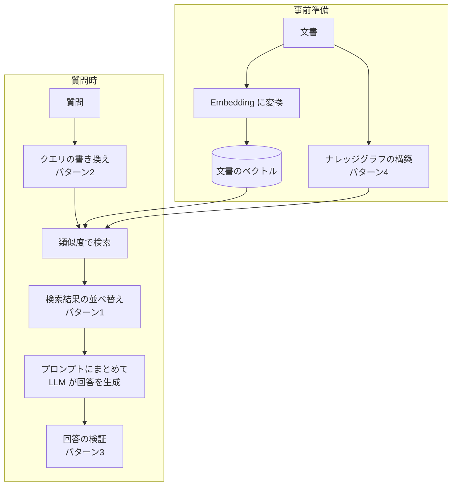
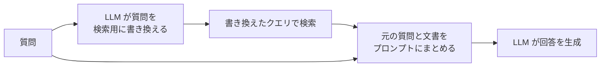

# Sarashina を利用した RAG 検索精度の改善 (1/2)

## はじめに

SB Intuitions 株式会社の林悠大です。

[前回の記事](https://www.sbintuitions.co.jp/blog/entry/2026/10/27/170000)では、RAG(検索拡張生成)の考え方と、Sarashina サービスの API 機能を使った最小構成の実装を紹介しました。そこで作ったのは、質問をそのまま Embedding に変換し、コサイン類似度が最も高い文書を1件だけ LLM に渡す、最もシンプルな RAG です。

このシンプルな検索は、文書数が少なく、質問と文書の表現が近い場合にはよく機能します。しかし実際のデータでは、必要な文書が検索結果の下位に埋もれたり、複数の文書にまたがる情報が必要な質問が来たりして、関連する文書を取りこぼすことがあります。

この記事では、こうした取りこぼしを減らすための代表的な手法を、Sarashina サービスの API 機能を使ったコードとともに紹介します。扱うパターンは次の4つです。

- パターン1: リランカーによる検索結果の並べ替え
- パターン2: クエリ書き換えによる検索クエリの改善
- パターン3: Chain of Verification (CoVe) による回答の検証
- パターン4: ナレッジグラフによる検索 (GraphRAG)

このテーマは2回に分けて紹介します。この記事ではリランカーとクエリ書き換えを扱い、パターン3以降は次の記事で紹介します。

## ナイーブな RAG の限界と改善の方向性

まず、前回の実装を振り返ります。質問時の処理は次の3ステップでした。

1. 質問を Embedding に変換する
2. 文書のベクトルとのコサイン類似度が最も高い文書を1件選ぶ
3. 質問とその文書をプロンプトにまとめ、LLM が回答を生成する

この記事では、この形をベースラインと呼びます。

### ナイーブな検索で起きる取りこぼし

ベースラインの検索は、1回の埋め込み比較だけで関連文書を決めます。そのため、次のような場面で取りこぼしが起きます。

- **順位付けの粗さ**: Embedding の類似度は高速な反面、関連性を細かく見極めるのは得意ではありません。必要な文書が2位以降に埋もれると、1件だけ取る構成では拾えません。
- **文書をまたぐ情報**: 「AとBの違いは?」のように複数の文書をあわせて初めて答えられる質問では、1件の検索では情報が足りません。

### 改善の方向性

これらの取りこぼしは、RAG の流れのどこで起きるかによって、対応する手法が変わります。



この記事では、図の各部分に対応する4つのパターンを紹介します。

- **パターン1: リランカーによる検索結果の並べ替え**: Embedding で候補を幅広く拾った後、リランカーが関連性を厳密に判定して並べ替えます。「順位付けの粗さ」に対応します。
- **パターン2: クエリ書き換えによる検索クエリの改善**: 検索の前に、LLM が質問を検索に適した形に書き換えます。書き換えの方針によって、疑問文を説明文調に整える、略称や前提を補う、複数の意図を別々の質問に分解する、といった使い分けができます。
- **パターン3: Chain of Verification (CoVe) による回答の検証**: 生成された回答の主張を文書で確かめ、裏付けのない部分を修正します。
- **パターン4: ナレッジグラフによる検索 (GraphRAG)**: 事前に文書からナレッジグラフを構築し、文書間のつながりを使って検索します。「文書をまたぐ情報」に対応します。

なお、こうした改善手法の全体像は、RAG のサーベイ論文(Gao et al., 2023)でも Advanced RAG や Modular RAG として整理されています[1]。

以降の節では、追加する処理が小さいものから順に、コードと実行例を示しながら実装を紹介していきます。
手法ごとに得意な場面が違うため、各節では、その手法の効果が出やすい例題を個別に用意します。例題はいずれも架空の家電メーカーに関するもので、文書は10件ずつです。各節の冒頭でベースラインでは答えにくい理由を確認してから、手法を実装します。

## 共通の準備

どのパターンでも使う処理を、ここでまとめて用意します。

必要なライブラリをインストールします。

```bash
pip install -U requests numpy python-dotenv
```

API キーは、.env ファイルに次のように書いておきます。

```
SARASHINA_API_KEY=取得したキー
```

次のコードで、API の設定と、4つの関数を用意します。コードと各関数の説明は、折りたたんであります。

<details>
<summary>共通のコードと各関数の説明(クリックで展開)</summary>

```python
import os
from functools import cache

import numpy as np
import requests
from dotenv import load_dotenv

load_dotenv()

API_BASE_URL = "https://api.sarashina.ai/v1"
HEADERS = {
    "Authorization": f"Bearer {os.environ['SARASHINA_API_KEY']}",
    "Content-Type": "application/json",
}
EMBEDDING_MODEL = "sarashina3-embedding"
CHAT_MODEL = "sarashina3-mini"


def chat(prompt: str) -> str:
    response = requests.post(
        f"{API_BASE_URL}/chat/completions",
        headers=HEADERS,
        json={"model": CHAT_MODEL, "messages": [{"role": "user", "content": prompt}]},
    )
    response.raise_for_status()
    return response.json()["choices"][0]["message"]["content"]


@cache
def embed_text(text: str, task_type: str) -> list[float]:
    response = requests.post(
        f"{API_BASE_URL}/embeddings",
        headers=HEADERS,
        json={"model": EMBEDDING_MODEL, "input": text, "task_type": task_type},
    )
    response.raise_for_status()
    return response.json()["data"][0]["embedding"]


def search_by_embedding(query: str, documents: list[str], top_n: int) -> list[int]:
    query_emb = np.asarray(embed_text(query, "RETRIEVAL_QUERY"))
    docs_emb = np.asarray([embed_text(doc, "RETRIEVAL_DOCUMENT") for doc in documents])

    similarities = (docs_emb @ query_emb) / (
        np.linalg.norm(docs_emb, axis=1) * np.linalg.norm(query_emb)
    )
    return np.argsort(similarities)[::-1][:top_n].tolist()


PROMPT_TEMPLATE = """
以下のユーザーからの質問に対して、参考文書に記載されている情報を用いて回答してください。

質問：{question}
参考文書：{rel}
"""


def generate_answer(question: str, document: str) -> str:
    return chat(PROMPT_TEMPLATE.format(question=question, rel=document))
```

各関数の役割は、次の通りです。

- chat: Chat Completions API を呼び出し、LLM の出力を返す
- embed_text: 文章を Embedding に変換する。検索する側の質問には `RETRIEVAL_QUERY`、検索される側の文書には `RETRIEVAL_DOCUMENT` を指定する。同じ文章の結果は使い回す(cache)ので、検索を繰り返しても、文書の Embedding を何度も計算しない
- search_by_embedding: 質問に近い順に、文書の番号を top_n 件返す。前回記事は最も近い1件だけを返していたので、top_n を1にするとベースラインと同じ動きになる
- generate_answer: 質問と文書1件をプロンプトにまとめ、LLM に回答を生成させる。前回記事と同じ処理

以降の節のコードは、このコードを実行した後に続けて実行する前提です。

</details>

## パターン1: リランカーによる検索結果の並べ替え

### 例題

答えを含む文書は1件ありますが、質問の言葉「保証期間」を多く含む別の文書のほうが、類似度で上位に来やすい例です。リランカーは質問との関連性を細かく見るので、答えの文書を上位に戻せます。

```python
DOCUMENTS = [
    "電気ケトル「わかしたて」は、容量1.0Lで、沸騰すると自動で電源が切れる。",
    "電気ケトル「わかしたて」の無償修理は、購入日から2年間受けられる。対象は本体のみで、パッキンなどの消耗品や、落下による破損は含まれない。",
    "炊飯器「ふっくら」の保証期間は、購入日から3年間である。",
    "「わかしたて」の保証期間中に故障した場合は、サポート窓口に連絡する。",
    "「わかしたて」の保証期間を過ぎた後の修理は、有償となる。",
    "「わかしたて」の保証期間について不明な点は、サポート窓口で案内している。",
    "「わかしたて」の保証書は、購入日の記載がないと無効になる場合がある。",
    "「わかしたて」の取扱説明書は、公式サイトからダウンロードできる。",
    "炊飯器「ふっくら」は、5.5合炊きである。",
    "「わかしたて」は、白と黒の2色で展開されている。",
]

QUESTION = "「わかしたて」の保証期間は何年ですか?"
```

この例の正解は「2年間」です。2番目の文書から回答できます。

### 仕組み

ベースラインの検索では、質問と文書を別々に Embedding に変換し、ベクトルの近さで比べていました。この方式は、文書のベクトルを事前に計算しておけるため高速です。一方で、質問と文書の組み合わせを一緒に読んでいるわけではありません。一方でリランカーは、質問と文書を1組にして入力し、その組が質問への答えとしてどれだけ適切かをスコアで返します。質問と文書の中身を突き合わせて読むため、Embedding より細かく関連性を見分けられます。ただし、文書1件ごとにモデルを動かすので、文書数が多いような場面ではコストが高くなってしまいます。

そこで、次の2段階で使います。

1. Embedding で、質問に近い文書を N 件ほど幅広く拾う
2. リランカーで N 件を並べ替え、上位の文書だけを LLM に渡す

1段目で速さを、2段目で精度を受け持つ分担です[2]。

Sarashina の [Rerank API](https://docs.sarashina.ai/api-reference/rerank) には、次の特徴があります。

- 1回のリクエストで渡せる文書は、1〜20件まで
- 結果には全ての文書が、スコアの高い順に入って返る
- 上位何件に絞るかを指定する項目はないため、絞り込みは呼び出し側で行う
- スコアは並べ替え用の指標で、確率ではない。関連性の低い文書でも 0.9 を超えることがあるので、固定のしきい値で足切りしない

また、リランカーは並べ替えしかできないため、そもそも答えの文書が1段目で取得した N 件に入っていなければリランカーの効果は発揮されません。そこで、 N は取りこぼしが出ない程度に大きく、かつ20件以下で決めます。

### 実装

共通の準備のコードに加えて、リランカーのモデル名を定義します。

```python
RERANK_MODEL = "sarashina3-rerank"
```

### Step 1: Embedding で候補を拾う

共通の準備の search_by_embedding で、質問に近い上位5件を候補にします。

```python
candidate_ids = search_by_embedding(QUESTION, DOCUMENTS, top_n=5)
candidates = [DOCUMENTS[i] for i in candidate_ids]
```

### Step 2: リランカーで並べ替える

Rerank API に、質問と候補の文書を渡します。task_type には、質問に答える文書を探す用途の `GENERAL_QA` を指定します。指定できる他の値は、[API ドキュメント](https://docs.sarashina.ai/api-reference/rerank)を参照してください。

結果の各要素の document_id は、渡した文書のリストの何番目かを表します。スコアの高い順に並んで返るので、番号だけを取り出せば並べ替えた順序になります。

```python
def rerank(query: str, documents: list[str]) -> list[int]:
    response = requests.post(
        f"{API_BASE_URL}/rerank",
        headers=HEADERS,
        json={
            "model": RERANK_MODEL,
            "query": query,
            "documents": documents,
            "task_type": "GENERAL_QA",
        },
    )
    response.raise_for_status()
    result = response.json()["data"][0]["result"]
    return [item["document_id"] for item in result]
```

### 実行して比較する

Step 1 の候補を使い、ベースラインとリランカーを比べます。ベースラインは、Embedding の1位の文書だけを渡します。リランカーは、5件の候補を並べ替えて、1位の文書だけを渡します。LLM に渡す文書は、どちらも1件です。

```python
# QUESTION = "「わかしたて」の保証期間は何年ですか?"

# ベースライン: Embedding の1位
baseline_doc = candidates[0]

# リランカー: 5件を並べ替えた1位
reranked_ids = rerank(QUESTION, candidates)
reranked_doc = candidates[reranked_ids[0]]

print("ベースライン:", baseline_doc)
print("リランカー:", reranked_doc)
# -> ベースライン: 「わかしたて」の保証期間について不明な点は、サポート窓口で案内している。
# -> リランカー: 電気ケトル「わかしたて」の無償修理は、購入日から2年間受けられる。対象は本体のみで、パッキンなどの消耗品や、落下による破損は含まれない。

print(generate_answer(QUESTION, baseline_doc))
# -> ご質問の「わかしたて」の保証期間については、具体的な年数が明記された情報がございません。保証期間に関する詳細やご不明点につきましては、お手数ですがサポート窓口までお問い合わせいただきますようお願い申し上げます。

print(generate_answer(QUESTION, reranked_doc))
# -> ご質問にお答えいたします。
#
# 「わかしたて」の保証期間は、購入日から2年間です。この期間中は無償で修理が受けられますが、保証の対象は本体のみとなります。パッキンなどの消耗品や、落下による破損などは保証の対象外ですので、ご注意ください。
```

ベースラインでは、「保証期間」という言葉を含む、答えのない文書が1位になりました。答えの文書は、Embedding では3位でした。そのため、LLM は年数を答えられていません。

リランカーを通すと、答えを含む文書が1位になります。LLM に渡る文書が変わり、「2年間」と正しく答えられました。

### 補足

N を増やすほど取りこぼしは減りますが、リランカーが読む文書が増えるため、時間と費用が増えます。LLM に渡す文書の件数は、質問の種類に応じて実験的に決めます。複数の文書が必要な質問では、上位の数件をまとめて渡します。

## パターン2: クエリ書き換えによる検索クエリの改善

### 例題

質問が口語的で、文書の言葉と一致しない例です。質問には「弾かれる」とありますが、答えの文書は「認証エラー」「パスワードの再設定」と書いています。LLM が質問を「アプリが起動できない問題の解決方法」のような形に書き換えると、検索で拾いやすくなります。

```python
DOCUMENTS = [
    "タケシバホームアプリは、タケシバ製作所の家電をスマートフォンから操作できる無料のアプリである。",
    "タケシバホームアプリは、iOS 16以上と、Android 12以上に対応している。",
    "タケシバホームアプリは、アプリストアで「タケシバホーム」と検索するとインストールできる。",
    "タケシバホームアプリに登録できる機器は、1つのアカウントにつき最大5台である。",
    "タケシバホームアプリで「認証エラー」が表示された場合は、ログイン画面の「パスワードを忘れた方」からパスワードを再設定する。",
    "パスワードの再設定用のメールは、登録したメールアドレスに送られる。",
    "タケシバホームアプリの画面表示は、設定から文字サイズを変更できる。",
    "タケシバホームアプリは、機器の運転状況を通知で知らせる。",
    "アカウントを削除すると、登録していた機器の設定も消える。",
    "タケシバホームアプリの利用には、インターネット接続が必要である。",
]

QUESTION = "タケシバのアプリ、開こうとすると弾かれるんだけど、どうしたらいい?"
```

この例の正解は「パスワードを再設定する」です。5番目の文書から回答できます。

### 仕組み

ユーザーが書く質問は、検索にそのまま使うには向かないことがあります。たとえば、次のようなものです。

- 話し言葉で書かれていて、文書の言葉づかいと合わない
- 略称や前提が省かれている
- 疑問文の形をしている。一方、文書は説明文で書かれている
- 複数の意図が1つの質問に混ざっている

Embedding は意味の近さで比べますが、言葉づかいが違うと、本来近いはずの文書の類似度が下がります。

クエリ書き換えは、検索の前に LLM で質問を書き換え、検索に適した形に直す手法です。書き換えたクエリで検索し、回答の生成には元の質問を使います。



書き換えの方針は、目的によって使い分けます。

- 話し言葉を書き言葉に直し、疑問文を説明文にする
- 略称や省略された前提を補う
- 複数の意図を含む質問を、1つずつの質問に分解し、それぞれで検索する

この記事の例題では、1つ目の方針を使います。分解する場合は、書き換え結果が複数になるので、検索も質問ごとに行い、結果をまとめます。

注意点もあります。書き換えを行う LLM は、検索対象の文書を見ていません。そのため正解の文書にある「認証エラー」のような言葉を、LLM が的確に補えるとは限りません。そのため、この手法は質問の意味を保ったまま言葉づかいを整える手法と考えてください。また、書き換えの分だけ LLM の呼び出しが増え、応答までの時間が長くなる点にも注意が必要です。

### 実装

共通の準備のコードを使います。追加するのは、質問を書き換える処理だけです。

### Step 1: 質問を書き換える

プロンプトには方針を箇条書きで書きます。結果はそのまま検索に使うので、モデルには書き換えたクエリだけを出力させます。

```python
REWRITE_PROMPT_TEMPLATE = """
以下のユーザーの質問を、文書を検索するためのクエリに書き換えてください。

- 話し言葉を、書き言葉に直す
- 省略されている語や前提を補う
- 疑問文ではなく、探している情報を説明する文にする
- 書き換えたクエリだけを、1行で出力する

質問：{question}
"""


def rewrite_query(question: str) -> str:
    return chat(REWRITE_PROMPT_TEMPLATE.format(question=question)).strip()
```

検索と回答の生成は、共通の準備の関数をそのまま使います。回答の生成には、書き換え前の元の質問を渡します。ユーザーが聞きたかったことに答えるためです。

### 実行して比較する

例題の文書と質問を使い、ベースラインと書き換えを比べます。ベースラインは、元の質問で検索します。書き換えは、書き換えたクエリで検索します。どちらも、回答の生成には元の質問を使います。

```python
# QUESTION = "タケシバのアプリ、開こうとすると弾かれるんだけど、どうしたらいい?"

rewritten = rewrite_query(QUESTION)
print("書き換え後のクエリ:", rewritten)
# -> 書き換え後のクエリ: タケシバのアプリが起動できない問題の解決方法

baseline_doc = DOCUMENTS[search_by_embedding(QUESTION, DOCUMENTS, top_n=1)[0]]
rewritten_doc = DOCUMENTS[search_by_embedding(rewritten, DOCUMENTS, top_n=1)[0]]

print("ベースライン:", baseline_doc)
print("書き換え:", rewritten_doc)
# -> ベースライン: タケシバホームアプリは、アプリストアで「タケシバホーム」と検索するとインストールできる。
# -> 書き換え: タケシバホームアプリで「認証エラー」が表示された場合は、ログイン画面の「パスワードを忘れた方」からパスワードを再設定する。

print(generate_answer(QUESTION, baseline_doc))
# -> ご質問の件について、参考文書に基づきご案内いたします。
#
# タケシバのアプリが開けないとのこと、お困りのことと存じます。まずは、アプリが正しくインストールされているかをご確認いただくために、アプリストア（App StoreやGoogle Playなど）にて「タケシバホーム」と検索し、最新のバージョンがインストールされているかをご確認ください。もし既にインストールされている場合でも、一度アンインストールしてから再インストールすることで問題が解決する場合がございます。(以下略)

print(generate_answer(QUESTION, rewritten_doc))
# -> ご質問の件について、参考文書に基づきご案内いたします。
#
# タケシバホームアプリ起動時に「認証エラー」が表示される場合、ログイン画面の「パスワードを忘れた方」からパスワードの再設定をお試しください。これにより、問題が解決する可能性があります。(以下略)
```

ベースラインでは、質問の「アプリ」「開く」に引きずられて、インストール方法の文書が1位になりました。LLM は答えの文書を見ておらず、再インストールを案内しています。

書き換えたクエリでは、「起動できない問題の解決方法」という言い方になり、ログインの不具合を扱う文書が1位になりました。LLM は、パスワードの再設定を案内できています。

## Japanese SimpleQA による定量的な評価

次に、これらの手法を公開されているベンチマークで定量的に評価しました。

使ったのは、Preferred Networks が公開する Japanese SimpleQA です[3]。特定の事実を尋ねる短い質問3,000問からなり、正解が一意に定まるように作られています。公開時点の最新モデルでも正答率が低く、LLM がどれだけ事実に基づいて正確に答えられるかを測るベンチマークです。

### 評価の設定

各質問に対し、日本語 Wikipedia から関連する文書を検索して LLM に渡し、回答を生成させます。検索対象の文書は、あらかじめ日本語 Wikipedia の各記事を512トークン以下のチャンクに分割し、チャンクごとに Embedding を計算したものです。検索でヒットしたチャンクの本文を、そのまま文書として LLM に渡します。比較したのは次の4つです。評価は3,000問すべてで行いました。

- **zero-shot**: 検索なし。LLM 自身の知識だけで回答する
- **naive**: ベースライン。Embedding で検索した上位5件を、そのまま質問と一緒に渡す
- **rerank**: パターン1の構成。Embedding で10件を拾い、リランカーで上位5件に絞って渡す
- **query rewrite**: パターン2の構成。LLM が質問を検索用のクエリに書き換え、それで検索した上位5件を渡す

回答の正誤は、LLM-as-a-Judge で判定します。Japanese SimpleQA と同じく、各回答を「正解している(correct)」「誤っている(incorrect)」「回答していない(not attempted)」の3つに分類します。指標は f1_score で、全質問に対する正解の割合(correct)と、回答した質問のうち正解した割合(correct given attempted)の調和平均です。多くの質問に、間違えずに答えるほど高くなります。

評価に用いたモデルは、記事内のデモコードと同じく次の3つです。

- 生成モデル(回答の生成とクエリ書き換え): Sarashina3 mini
- 埋め込みモデル: Sarashina3 embedding
- リランキングモデル: Sarashina3 rerank

### 結果

| 手法 | f1_score |
|---|---|
| zero-shot | 0.312 |
| naive | 0.938 |
| rerank | 0.948 |
| query rewrite | 0.881 |

検索を加えると、zero-shot の 0.312 から 0.9 台まで大きく改善しました。このベンチマークの質問の多くは日本語 Wikipedia に答えがあり、関連文書を見つけて渡すことが、そのまま正答率につながっています。

リランカーは、ベースラインをさらに上回りました。ベースラインでも多くの質問に答えられるため差は小さいですが、埋もれていた文書を上位に戻す効果は、この規模のデータでも確認できました。

クエリ書き換えは、ベースラインを下回りました。ベンチマークの質問は「〜は誰か」「〜はいつか」のように短く整っていて、そのまま検索に使えます。書き換えで余計な言い換えが加わることで、かえって検索精度を下げたと考えられます。同様の現象は、Kotte (2026) の実験でも報告されています[4]。質問と文書の言葉づかいがもとから近い場合、書き換えによって質問中の用語が置き換わると、かえって検索精度が下がることが示されています。パターン2の節で扱った、口語的で文書と言葉づかいが合わない質問とは状況が違い、この手法が得意な場面でなかったことが裏付けられました。

このように、手法の効果はデータに依存します。次の節では、この結果も踏まえて、どの手法を選ぶかの指針を整理します。

## 使い分けの指針

2つのパターンは、それぞれ RAG の流れの別の場所に手を入れます。取りこぼしの原因に合わせて選びます。

| パターン | 向いている場面 | 追加で必要なもの |
|---|---|---|
| リランカー | 答えの文書が検索結果の2位以降に埋もれる | Rerank API の呼び出し1回 |
| クエリ書き換え | 質問が口語的で、文書の言葉づかいと合わない | LLM の呼び出し1回 |

どちらも追加する処理が小さいため、検索の改善を試す最初の候補になります。２つの手法を組み合わせて利用するケースも候補としては十分考えられます。たとえば、書き換えたクエリで検索し、リランカーで並べ替えるというような構成です。ただし、足すほど回答を作るのにかかる時間は長くなり、コストも高くなる点には注意が必要です。

CoVe と GraphRAG を含めた、4つのパターン全体の使い分けの指針は、次の記事で整理します。

## おわりに

この記事では、前回のシンプルな RAG を出発点に、検索の取りこぼしを減らす4つのパターンのうち、最初の2つを紹介しました。

- リランカーで、検索結果の順位を整える
- クエリ書き換えで、質問を検索しやすい形にする

次の記事では、残りの2つを紹介します。

- CoVe で、回答の根拠を確かめる
- GraphRAG で、文書のつながりをたどる

例題はいずれも小さなものです。実際のデータでは、効果の出方が変わります。実システムに導入する際には、利用するデータを使って精度を検証しながら適切な手法を選択することが必要になります。

## 参考文献

1. Gao et al., "Retrieval-Augmented Generation for Large Language Models: A Survey", 2023. https://arxiv.org/abs/2312.10997
2. Nogueira & Cho, "Passage Re-ranking with BERT", 2019. https://arxiv.org/abs/1901.04085
3. 三上裕明, 鈴木脩司, "Japanese SimpleQA: 日本語における事実に基づいた回答能力の評価ベンチマーク", 2025. https://github.com/pfnet-research/japanese-simpleqa
4. Kotte, "Not All Queries Need Rewriting: When Prompt-Only LLM Refinement Helps and Hurts Dense Retrieval", 2026. https://arxiv.org/abs/2603.13301
5. Wikipedia 日本語版, https://ja.wikipedia.org/ (CC BY-SA 4.0: https://creativecommons.org/licenses/by-sa/4.0/deed.ja)
