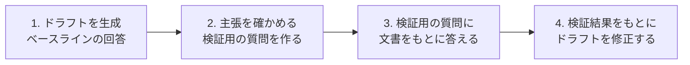
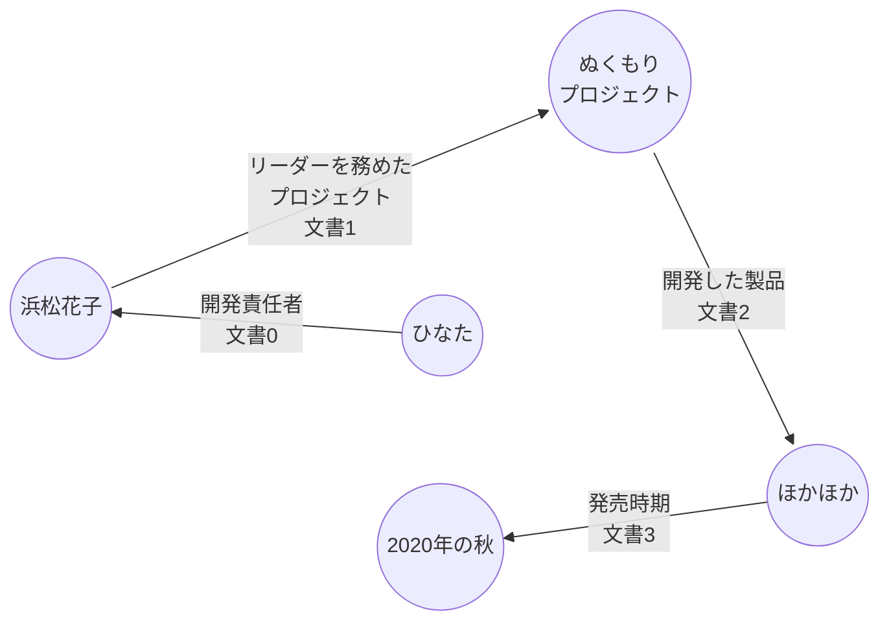

# Sarashina を利用した RAG 検索精度の改善 (2/2)

## はじめに

SB Intuitions 株式会社の林悠大です。

[前回の記事](https://www.sbintuitions.co.jp/blog/entry/2026/11/12/170000)では、RAG(検索拡張生成)の検索で起きる取りこぼしを減らすための手法として、リランカーによる検索結果の並べ替えと、クエリ書き換えによる検索クエリの改善を紹介しました。

この記事では、残りの2つのパターンを紹介します。

- **パターン3: Chain of Verification (CoVe) による回答の検証**: 生成された回答の主張を文書で確かめ、裏付けのない部分を修正します。検索した文書は正しいのに、回答に根拠のない内容が混ざる場合に対応します。
- **パターン4: ナレッジグラフによる検索 (GraphRAG)**: 事前に文書からナレッジグラフを構築し、文書間のつながりを使って検索します。複数の文書をたどらないと答えられない質問に対応します。

記事の最後では、前回の2つとあわせた4つのパターンの、使い分けの指針を整理します。

前回と同じく、質問を Embedding に変換し、最も近い文書1件を LLM に渡すシンプルな RAG をベースラインと呼びます。各節では、その手法の効果が出やすい例題を個別に用意します。例題はいずれも架空の家電メーカーに関するもので、文書は10件ずつです。各節の冒頭で、ベースラインでは答えにくい理由を確認してから、手法を実装します。

## 共通の準備

どのパターンでも使う処理を、ここでまとめて用意します。

必要なライブラリをインストールします。

```bash
pip install -U requests numpy python-dotenv
```

API キーは、.env ファイルに次のように書いておきます。

```
SARASHINA_API_KEY=取得したキー
```

次のコードで、API の設定と、4つの関数を用意します。コードと各関数の説明は、折りたたんであります。

<details>
<summary>共通のコードと各関数の説明(クリックで展開)</summary>

```python
import os
from functools import cache

import numpy as np
import requests
from dotenv import load_dotenv

load_dotenv()

API_BASE_URL = "https://api.sarashina.ai/v1"
HEADERS = {
    "Authorization": f"Bearer {os.environ['SARASHINA_API_KEY']}",
    "Content-Type": "application/json",
}
EMBEDDING_MODEL = "sarashina3-embedding"
CHAT_MODEL = "sarashina3-mini"


def chat(prompt: str) -> str:
    response = requests.post(
        f"{API_BASE_URL}/chat/completions",
        headers=HEADERS,
        json={"model": CHAT_MODEL, "messages": [{"role": "user", "content": prompt}]},
    )
    response.raise_for_status()
    return response.json()["choices"][0]["message"]["content"]


@cache
def embed_text(text: str, task_type: str) -> list[float]:
    response = requests.post(
        f"{API_BASE_URL}/embeddings",
        headers=HEADERS,
        json={"model": EMBEDDING_MODEL, "input": text, "task_type": task_type},
    )
    response.raise_for_status()
    return response.json()["data"][0]["embedding"]


def search_by_embedding(query: str, documents: list[str], top_n: int) -> list[int]:
    query_emb = np.asarray(embed_text(query, "RETRIEVAL_QUERY"))
    docs_emb = np.asarray([embed_text(doc, "RETRIEVAL_DOCUMENT") for doc in documents])

    similarities = (docs_emb @ query_emb) / (
        np.linalg.norm(docs_emb, axis=1) * np.linalg.norm(query_emb)
    )
    return np.argsort(similarities)[::-1][:top_n].tolist()


PROMPT_TEMPLATE = """
以下のユーザーからの質問に対して、参考文書に記載されている情報を用いて回答してください。

質問：{question}
参考文書：{rel}
"""


def generate_answer(question: str, document: str) -> str:
    return chat(PROMPT_TEMPLATE.format(question=question, rel=document))
```

各関数の役割は、次の通りです。

- chat: Chat Completions API を呼び出し、LLM の出力を返す
- embed_text: 文章を Embedding に変換する。検索する側の質問には `RETRIEVAL_QUERY`、検索される側の文書には `RETRIEVAL_DOCUMENT` を指定する。同じ文章の結果は使い回す(cache)ので、検索を繰り返しても、文書の Embedding を何度も計算しない
- search_by_embedding: 質問に近い順に、文書の番号を top_n 件返す。最も近い1件だけを返す、top_n を1とした場合がベースラインと同じ動きになる
- generate_answer: 質問と文書1件をプロンプトにまとめ、LLM に回答を生成させる

以降の節のコードは、このコードを実行した後に続けて実行する前提です。

</details>

## パターン3: Chain of Verification (CoVe) による回答の検証

### 例題

検索で渡された文書は正しいのに、LLM が文書にない内容を付け足してしまう例です。文書に書かれているのは、「福岡工場は、九州地方の物流拠点にも近い」という1点だけです。ところが、ベースラインの回答には、輸送効率の向上やコストの削減といった、文書にない説明が加わりがちです。具体的な誤答例は、後述の「実行して比較する」で示します。回答の主張を1つずつ文書で確かめられれば、書かれていない部分を取り除けます。

```python
DOCUMENTS = [
    "タケシバ製作所の愛知工場は、1965年に稼働を開始した。",
    "愛知工場の従業員数は、約800人である。",
    "愛知工場では、主に炊飯器と電気ケトルを生産している。",
    "タケシバ製作所の福岡工場は、2010年に稼働を開始した。",
    "福岡工場では、主に洗濯機を生産している。",
    "福岡工場は、九州地方の物流拠点にも近い。",
    "タケシバ製作所は、国内に愛知工場と福岡工場の2つの工場を持つ。",
    "愛知工場の敷地面積は、約12万平方メートルである。",
    "福岡工場の見学は、事前予約制である。",
    "タケシバ製作所の本社は、愛知県にある。",
]

QUESTION = "福岡工場の立地には、どのような利点がありますか?"
```

この例の正解は「九州地方の物流拠点に近いこと」です。6番目の文書から回答できます。文書には、輸送効率やコストへの影響は書かれていません。

### 仕組み

LLM は、自分が書いた回答の誤りには気づきにくい性質があります。回答を書いた直後に「この回答は正しいですか」と聞いても、同意が返りやすくなります。

Chain of Verification (CoVe) は、Dhuliawala et al. (2023) で提案された手法です[1]。回答を作った後に、回答の主張を1つずつ確かめ直し、裏付けのない部分を直します。次の4ステップで進めます。



ポイントは、3の検証をドラフトとは切り離して行うことです。ドラフトを見せたまま確認させると、ドラフトに同意する方向に引きずられます。検証用の質問には、ドラフトを見せずに、質問と文書だけで答えさせます。

この記事の実装は、原論文の手法を RAG 向けに簡略化しています。検証では、LLM 自身の知識ではなく、検索した文書を根拠にします。

この記事の例では、文書から常識的には推論できても、文書には書かれていない内容を補ってしまうケースを扱います。この実装で確かめるのは、誤りの原因ではなく、各主張が文書に直接書かれているかです。そのため、このような推論の補完と、主体や数値の読み違いによる誤りの両方を検証対象にできます。

ただし、原論文の評価は外部文書を使わない設定で、推論の補完と文書の読み違いを区別した実験ではありません。今回の例で確認できるのは、文書にない推論の追記を取り除ける場合があるという点です。また、直接引用を要求するため、文書から妥当に導ける内容も「記載なし」として取り除くことがあります。

また、実際に試す中で、次の3点が結果を左右しました。

- 検証用の質問は、「はい」「いいえ」で答える形にしない。「〜は文書に書かれていますか」と聞くと、書かれていなくても「はい」と答えることがある。「何」「どのように」で尋ねる
- 検証では、根拠になる文を引用させるか、「記載なし」と答えさせる。「〜と考えられます」のような推測を書かせない
- 修正では、「記載なし」とされた主張を取り除かせる。取り除いた内容を「文書に記載がある」と書き足させない

注意点もあります。LLM の呼び出しが増えます。この例では、ドラフト1回、質問の作成1回、検証3回、修正1回の、合わせて6回です。

### 実装

共通の準備のコードを使います。ドラフトの生成は、ベースラインと同じ generate_answer です。追加するのは、検証と修正のための処理です。

### Step 1: 検証用の質問を作る

ドラフトから主張を抜き出し、それを確かめる質問を作らせます。出力は1行に1つの質問にして、行ごとに分けて取り出します。

```python
PLAN_PROMPT_TEMPLATE = """
以下の質問へのドラフトから、事実についての主張を抜き出し、それぞれの根拠を確認するための質問を作ってください。

- ドラフトの主張ごとに、1つの質問にする。質問は、最大3つまで
- 「はい」「いいえ」では答えられない、「何」「どのように」などで尋ねる質問にする
- ドラフトの言い回しは使わず、主張の中心になる事実だけを尋ねる
- 1行に1つ、質問だけを出力する

質問：{question}
ドラフト：{draft}
"""


def plan_verification_questions(question: str, draft: str) -> list[str]:
    output = chat(PLAN_PROMPT_TEMPLATE.format(question=question, draft=draft))
    return [line.strip() for line in output.splitlines() if line.strip()]
```

### Step 2: 文書をもとに検証する

検証用の質問ごとに、Embedding で文書を検索し、その文書をもとに答えさせます。ここで、ドラフトは渡しません。

```python
VERIFY_PROMPT_TEMPLATE = """
以下の質問への答えが、参考文書に書かれているかを確認してください。

- 質問に直接答える文が参考文書にある場合は、その文をそのまま引用する
- そうでない場合は、「記載なし」とだけ答える
- 推測や解釈は書かない。引用か「記載なし」のどちらかだけを出力する

質問：{question}
参考文書：{rel}
"""


def verify(verification_question: str, documents: list[str]) -> str:
    doc_id = search_by_embedding(verification_question, documents, top_n=1)[0]
    return chat(
        VERIFY_PROMPT_TEMPLATE.format(
            question=verification_question, rel=documents[doc_id]
        )
    )
```

### Step 3: 検証結果をもとに修正する

質問とドラフトに、検証結果を加えて渡し、回答を直させます。

```python
REVISE_PROMPT_TEMPLATE = """
以下の質問に対するドラフトを、確認結果をもとに修正してください。

- 確認結果に引用がある主張だけを、回答に残す
- 確認結果が「記載なし」の質問に対応する主張は、回答から取り除く
- 取り除いた主張について、「文書に記載がある」などと書き足さない
- 修正後の回答だけを出力する

質問：{question}
ドラフト：{draft}
確認結果：
{verification}
"""


def revise(question: str, draft: str, verification: str) -> str:
    return chat(
        REVISE_PROMPT_TEMPLATE.format(
            question=question, draft=draft, verification=verification
        )
    )
```

### 実行して比較する

例題の文書と質問で、ドラフト(ベースラインの回答)と、CoVe で修正した回答を比べます。

```python
# QUESTION = "福岡工場の立地には、どのような利点がありますか?"

doc_id = search_by_embedding(QUESTION, DOCUMENTS, top_n=1)[0]
draft = generate_answer(QUESTION, DOCUMENTS[doc_id])
print("ドラフト:", draft)
# -> ドラフト: ご質問にお答えいたします。
#
# 福岡工場の立地の利点として、九州地方の物流拠点に近いことが挙げられます。これにより、輸送効率の向上や物流コストの削減が期待できると考えられます。

verification_questions = plan_verification_questions(QUESTION, draft)
print("検証用の質問:", verification_questions)
# -> 検証用の質問: ['九州地方の物流拠点に近いことで、具体的にどのような輸送効率の向上が見込まれますか?', '物流コストの削減は、どの程度の規模や範囲で実現可能とされていますか?', '福岡工場の立地が、他の地域と比較して特に有利とされる要因は何ですか?']

results = [
    f"質問：{vq}\n回答：{verify(vq, DOCUMENTS)}" for vq in verification_questions
]
verification = "\n\n".join(results)
print("検証結果:", verification)
# -> 検証結果: 質問：九州地方の物流拠点に近いことで、具体的にどのような輸送効率の向上が見込まれますか?
# 回答：記載なし
#
# 質問：物流コストの削減は、どの程度の規模や範囲で実現可能とされていますか?
# 回答：記載なし
#
# 質問：福岡工場の立地が、他の地域と比較して特に有利とされる要因は何ですか?
# 回答：「福岡工場は、九州地方の物流拠点にも近い。」

print("修正後:", revise(QUESTION, draft, verification))
# -> 修正後: ご質問にお答えいたします。
#
# 福岡工場の立地の利点として、九州地方の物流拠点にも近いことが挙げられます。
```

ドラフトには、文書にない「輸送効率の向上」「物流コストの削減」が含まれていました。検証では、この2つについての質問が「記載なし」となりました。修正後の回答は、文書に書かれている内容だけになっています。

## パターン4: ナレッジグラフによる検索 (GraphRAG)

### 例題

答えを出すには、複数の文書を順にたどる必要がある例です。質問に出てくる「ひなた」から、開発責任者、過去のプロジェクト、製品、発売時期と、4件の文書がつながっています。後ろの文書には「ひなた」が出てこないため、類似度だけでは拾えません。

```python
DOCUMENTS = [
    "「ひなた」は、タケシバ製作所が2024年に発売した家庭用のスマート給湯器である。スマートフォンから湯温や入浴時間を設定できる。開発責任者は浜松花子が務めた。",
    "浜松花子は、2018年から2021年まで「ぬくもりプロジェクト」のリーダーを務めた。2022年に給湯器事業部へ異動した。",
    "「ぬくもりプロジェクト」では、温度センサーで床暖房を自動制御するコントローラー「ほかほか」が開発された。",
    "「ほかほか」は、2020年の秋に発売された。",
    "「ひだまり」は、タケシバ製作所が2023年に発売した家庭用の電気ストーブである。開発責任者は大門太郎が務めた。",
    "大門太郎は、2015年から2019年まで「あおぞらプロジェクト」のリーダーを務めた。",
    "「あおぞらプロジェクト」では、衣類乾燥に使える除湿機「からっと」が開発された。「からっと」は2017年の春に発売された。",
    "タケシバ製作所は1962年に創業した家電メーカーで、本社は愛知県にある。",
    "タケシバ製作所の給湯器事業部は2022年に新設された。「ひなた」はこの事業部の最初の製品である。",
    "床暖房のコントローラーを選ぶときは、対応する熱源の種類や、設置する部屋の広さを確認するとよい。",
]

QUESTION = "「ひなた」の開発責任者が以前リーダーを務めたプロジェクトで開発された製品は、いつ発売されましたか?"
```

この例の正解は「2020年の秋」です。1番目から4番目の文書を順にたどることで回答できます。

### 仕組み

これまでの検索は、質問に近い文書を、文書ごとに独立して選んでいました。文書どうしのつながりは使っていません。「Aの責任者が担当した別の件」のように、文書をたどって答えを出す質問では、後ろの文書が質問と似ていないため、拾えません。

ナレッジグラフは、文書に出てくる人や製品などをノード、その関係を辺で表したものです。辺は、「ひなた」「開発責任者」「浜松花子」のように、主語、関係、目的語の3つ組で表せます。この記事では、各辺に、元の文書の番号も持たせます。

例題の文書4件をグラフにすると、次のようになります。



文書からナレッジグラフを作り、そのつながりを検索に使う手法は、Edge et al. (2024) で GraphRAG として提案されています[2]。この記事のデモは、その考え方を簡略化したものです。

質問時の処理は、次の通りです。

1. 質問に出てくるエンティティを起点にする
2. 起点から辺を数ホップたどる
3. たどった辺の元の文書を集める
4. 集めた文書と質問をLLM に渡して回答を生成する

類似度で文書を選ばないので、質問と言葉が重ならない文書も、つながりをたどって拾えます。

この記事のデモでは、グラフを手書きの辞書で用意します。実際のデータでは、LLM に文書を読ませて、3つ組を抽出し、グラフを作ります。

注意点もあります。

- グラフの質が、そのまま検索の質になる。抽出の漏れや、同じ対象の表記の揺れ(名寄せ)があると、辺がつながらない
- ホップ数を増やすほど、質問に関係の薄い文書も集まる
- 文書ごとに LLM で抽出するので、構築に時間と費用がかかる

### 実装

共通の準備のコードを使います。

### Step 1: グラフを用意する

エンティティをキーにした辞書で、グラフを表します。値は、そのエンティティから出る辺の一覧です。辺は、関係、つながる先、元の文書の番号の3つ組です。

```python
GRAPH = {
    "ひなた": [("発売年", "2024年", 0), ("開発責任者", "浜松花子", 0)],
    "浜松花子": [
        ("リーダーを務めたプロジェクト", "ぬくもりプロジェクト", 1),
        ("異動先", "給湯器事業部", 1),
    ],
    "ぬくもりプロジェクト": [("開発した製品", "ほかほか", 2)],
    "ほかほか": [("発売時期", "2020年の秋", 3)],
    "ひだまり": [("発売年", "2023年", 4), ("開発責任者", "大門太郎", 4)],
    "大門太郎": [("リーダーを務めたプロジェクト", "あおぞらプロジェクト", 5)],
    "あおぞらプロジェクト": [("開発した製品", "からっと", 6)],
    "からっと": [("発売時期", "2017年の春", 6)],
    "タケシバ製作所": [("創業", "1962年", 7), ("本社の所在地", "愛知県", 7)],
    "給湯器事業部": [("新設", "2022年", 8), ("最初の製品", "ひなた", 8)],
}
```

### Step 2: グラフをたどって文書を集める

まず、質問の文字列に含まれるエンティティを、起点にします。次に、起点から辺を、ホップ数の上限までたどり、通った辺の元の文書の番号を集めます。同じエンティティを2回たどらないよう、たどり済みを記録します。

```python
def find_entities(question: str, graph: dict) -> list[str]:
    return [entity for entity in graph if entity in question]


def collect_doc_ids(graph: dict, start_entities: list[str], max_hops: int) -> list[int]:
    visited = set(start_entities)
    frontier = start_entities
    doc_ids: list[int] = []
    for _ in range(max_hops):
        next_frontier = []
        for entity in frontier:
            for _relation, target, doc_id in graph.get(entity, []):
                if doc_id not in doc_ids:
                    doc_ids.append(doc_id)
                if target not in visited:
                    visited.add(target)
                    next_frontier.append(target)
        frontier = next_frontier
    return doc_ids
```

この例題の質問は、「ひなた」から、4本の辺をたどると答えに着きます。そのため、ホップ数の上限は4にします。

### 実行して比較する

ベースラインは、Embedding の1位の文書だけを渡します。グラフの方式は、集めた文書をまとめて渡します。集めた文書は改行でつなぎ、generate_answer にそのまま渡します。

```python
# QUESTION = "「ひなた」の開発責任者が以前リーダーを務めたプロジェクトで開発された製品は、いつ発売されましたか?"

start_entities = find_entities(QUESTION, GRAPH)
print("起点のエンティティ:", start_entities)
# -> 起点のエンティティ: ['ひなた']

doc_ids = collect_doc_ids(GRAPH, start_entities, max_hops=4)
print("集めた文書の番号:", doc_ids)
# -> 集めた文書の番号: [0, 1, 2, 8, 3]

graph_context = "\n".join(DOCUMENTS[i] for i in doc_ids)
baseline_doc = DOCUMENTS[search_by_embedding(QUESTION, DOCUMENTS, top_n=1)[0]]

print(generate_answer(QUESTION, baseline_doc))
# -> ご質問にお答えいたします。
#
# 「ひなた」の開発責任者である浜松花子氏が以前リーダーを務めたプロジェクトで開発された製品については、提供された参考文書内に具体的な情報や発売日の記載がありません。そのため、現時点ではその製品の発売時期について特定することはできません。(以下略)

print(generate_answer(QUESTION, graph_context))
# -> ご質問にお答えいたします。
#
# 「ひなた」の開発責任者である浜松花子氏が以前リーダーを務めた「ぬくもりプロジェクト」で開発された製品「ほかほか」は、**2020年の秋**に発売されました。
```

集めた文書は、答えに必要な文書0から3と、給湯器事業部に関する文書8です。文書8は、浜松花子の異動先をたどった先で拾われたものです。回答には使いませんが、回答の邪魔にもなっていません。

ベースラインでは、質問に最も近い文書0だけが渡されました。開発責任者が浜松花子だと分かっても、その先の文書がないため、LLM は答えられません。グラフの方式では、つながりをたどって、後ろの文書も集められるので、正しく答えられました。

## 使い分けの指針

4つのパターンは、それぞれ RAG の流れの別の場所に手を入れます。取りこぼしの原因に合わせて選びます。

| パターン | 向いている場面 | 追加で必要なもの |
|---|---|---|
| リランカー | 答えの文書が検索結果の2位以降に埋もれる | Rerank API の呼び出し1回 |
| クエリ書き換え | 質問が口語的で、文書の言葉づかいと合わない | LLM の呼び出し1回 |
| CoVe | 文書は合っているのに、回答に根拠のない内容が混ざる | LLM の呼び出し数回 |
| GraphRAG | 複数の文書をたどらないと答えられない | グラフの構築 |

導入の手間と実行時のコストも、判断の材料になります。

- リランカーとクエリ書き換えは、追加する処理が小さい。最初に試す候補になる
- CoVe は、LLM の呼び出しが増え、応答が遅くなる。誤りが許されない用途で使う
- GraphRAG は、グラフの構築に手間がかかる。文書をまたぐ質問が多いデータで使う

パターンは組み合わせることもできます。たとえば、書き換えたクエリで検索し、リランカーで並べ替え、最後に CoVe で回答を確かめる構成です。ただし、足すほど回答を作るのにかかる時間は長くなり、コストも高くなります。

## おわりに

前編とあわせて、シンプルな RAG を出発点に、検索の取りこぼしを減らす4つのパターンを紹介しました。

- リランカーで、検索結果の順位を整える
- クエリ書き換えで、質問を検索しやすい形にする
- CoVe で、回答の根拠を確かめる
- GraphRAG で、文書のつながりをたどる

例題はいずれも小さなものです。実際のデータでは、効果の出方が変わります。実システムに導入する際には、利用するデータを使って精度を検証しながら適切な手法を選択することが必要になります。

## 参考文献

1. Dhuliawala et al., "Chain-of-Verification Reduces Hallucination in Large Language Models", 2023. https://arxiv.org/abs/2309.11495
2. Edge et al., "From Local to Global: A Graph RAG Approach to Query-Focused Summarization", 2024. https://arxiv.org/abs/2404.16130
